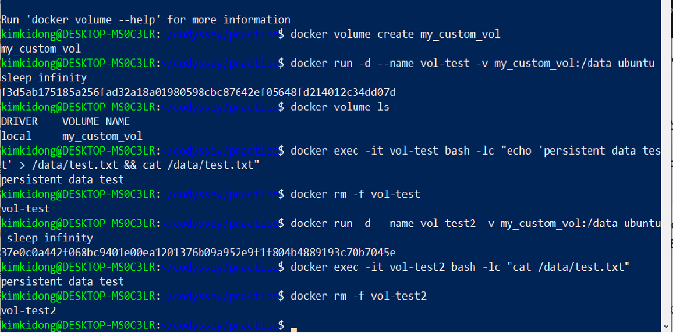
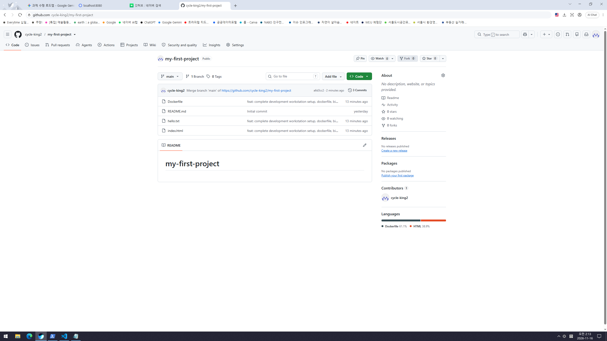

Markdown
## 1. 프로젝트 개요
로컬 개발 환경의 핵심 도구인 터미널(CLI), Docker(컨테이너), Git/GitHub(버전 관리 및 협업)를 직접 세팅하고 검증하여, 어디서든 재현 가능한 개발 워크스테이션을 구축하는 실습입니다.

---

## 2. 실행 환경
* **OS:** Windows 11 (WSL 2 Ubuntu 기반 Docker Engine)
* **Shell / Terminal:** PowerShell, Bash
* **Docker:** Docker Desktop 4.99.0 (Engine 29.9.3)
* **Git:** Git for Windows / WSL Git

---

## 3. 수행 항목 체크리스트
- [x] 터미널 기본 조작 및 작업 디렉토리 구성
- [x] 파일 및 디렉토리 권한 변경 실습
- [x] Docker 설치 및 버전/데몬 점검
- [x] 기본 컨테이너 (`hello-world`, `ubuntu`) 실행 및 운영 명령 확인
- [x] 커스텀 `Dockerfile` 작성 및 웹 서버 이미지 빌드
- [x] 포트 매핑 (`-p`)을 통한 브라우저 접속 확인
- [x] 바인드 마운트 실시간 반영 및 Docker 볼륨 영속성 검증
- [x] Git 사용자 설정 및 VS Code-GitHub 저장소 연동

---

## 4. 수행 로그 및 검증 결과

### 4-1. 작업 디렉토리 및 기본 파일 생성 (PowerShell)
```text
project-step-1/
├── Dockerfile          # Nginx 기반 커스텀 웹 서버 이미지 빌드를 위한 설정 파일
├── README.md           # 개발 환경 구축, 명령어 실습 기록 및 재현 가이드 문서
├── app.txt             # 파일 생성·복사·이동·삭제 등 기본 셸 명령어 실습용 파일
└── hello.txt           # 파일 권한(chmod 755 등) 변경 및 권한 해석 실습용 파일

- Dockerfile: nginx:alpine 베이스 이미지를 기반으로 정적 웹 서버 환경을 컨테이너로 빌드하기 위한 정의 파일입니다. 다른 사용자가 동일 명령어(docker build -t my-practice-app .)로 오류 없이 이미지를 생성할 수 있도록 합니다. 

- README.md: 개발 환경 구축, 명령어 실습 내용, 환경 설정방법(WSL2 및 Docker 연동), 트러블슈팅 사례, 그리고 재현을 위한 명령어 순서를 기록한 핵심 문서입니다. 시스템을 처음 접하는 사람도 문서에 적힌 순서 그대로 따라 실행했을 때 동일한 결과(웹 서버 구동 및 포트 매핑)를 얻을 수 있도록 기준을 제공합니다.

- app.txt and hello.txt: 리눅스/WSL 환경에서의 파일 조작(cp, mv, rm)과 파일 접근 권한 제어(chmod, 소유권 확인) 실습을 위해 루트 경로에 배치된 샘플 데이터 파일입니다.


**검증 방법:** `pwd`, `mkdir`, `echo`, `Get-ChildItem -Force` 명령어로 작업 경로를 생성하고 숨김 파일 포함 목록을 확인했습니다.

```powershell
PS C:\Users\sease> pwd

Path
----
C:\Users\sease
PS C:\Users\sease> cd..
PS C:\Users> cd..
PS C:\> mkdir -p codyssey/practice

    디렉터리: C:\codyssey

Mode                LastWriteTime         Length Name
----                -------------         ------ ----
d-----     2026-11-16  오전 12:17                practice


PS C:\> cd codyssey/practice
PS C:\codyssey\practice> echo "123" > test.txt
PS C:\codyssey\practice> get-childitem -force

    디렉터리: C:\codyssey\practice

Mode                LastWriteTime         Length Name
----                -------------         ------ ----
-a----     2026-11-16  오전 12:18             12 test.txt


4-2. Docker 설치 및 기본 점검

Docker image와 container란?
"이미지는 설계도(틀), 컨테이너는 그 설계도로 찍어낸 실물(실행 중인 상태)입니다."
- 이미지 : 애플리케이션 실행에 필요한 코드, 라이브러리, 환경 설정 등을 모아둔 읽기 전용(Read-only) 템플릿
- 컨테이너 : 이미지를 실행(Run)하여 메모리에 적재하고, 실제로 프로세스가 동작하는 상태

(특징)
가. 이미지는 원본 파일은 절대 변경되지 않음(수정 불가)
나. 컨테이너 내부에서 파일 생성·수정·삭제 등 쓰기(Write) 작업 가능
다. 이미지는 프로그램 설치 파일(ISO) 또는 붕어빵 틀이라고 이해하면 됨. 
라. 컨테이너는 설치를 마쳐 실행 중인 프로그램 또는 틀로 찍어낸 실제 붕어빵

(추가설명) Dockerfile이란?

- 도커파일(Dockerfile)은 도커 컨테이너의 뼈대가 되는 도커 이미지(Docker Image)를 자동으로 생성(Build)하기 위해 필요한 모든 지침과 설정들을 순차적으로 적어둔 텍스트 파일입니다.
- 일종의 설계도(Blueprint) : 애플리케이션 실행을 위해 어떤 운영체제(베이스 이미지)를 쓰고, 어떤 라이브러리와 프로그램을 설치해야 하며, 소스 코드를 어디에 배치하고 어떻게 실행해야 하는지 기록한 레시피로 이해하면 됩니다.
- 도커파일을 사용하는 이유는, "내 컴퓨터에서는 잘 되는데 서버에서는 안 돼요" 같은 환경 차이 문제를 원천로 방지합니다. 수동으로 일일이 명령어를 입력할 필요 없이 docker build 명령어 한 번으로 일관된 이미지를 만들어냅니다.
- Git 같은 형상 관리 도구로 소스 코드와 함께 관리할 수 있어 환경 변경 이력을 쉽게 추적할 수 있습니다.

<도커파일 생성 예시>
# 1. 가볍고 성능이 좋은 Nginx Alpine 리눅스 이미지를 베이스로 사용합니다.
# 2. 호스트(내 컴퓨터)에 있는 웹 페이지 파일을 컨테이너 내부의 Nginx 기본 경로로 복사합니다.
# 3. 컨테이너 내부에서 사용할 포트(80번)를 외부에 노출한다고 명시합니다.
FROM nginx:alpine
COPY index.html /usr/share/nginx/html/index.html
EXPOSE 80


(추가설명2) 절대경로와 상대경로

가. 절대 경로 : 컴퓨터 파일 시스템의 최상위 루트(Root) 폴더부터 시작해서 목적지까지 거치는 모든 경로를 빠짐없이 적어주는 방식입니다. 내가 지금 어디에 서 있든 상관없이 항상 고정된 하나의 위치를 가리킵니다.

<예시>
- 윈도우 : C:\Users\kimkidong\project\index.html
- 리눅스/맥: /home/kimkidong/project/index.html

컨테이너를 실행할 때 내 컴퓨터의 폴더를 연결(-v 옵션)하는 경우, 실행하는 위치에 따라 경로가 꼬이지 않도록 항상 최상위부터 정확히 지정하는 절대 경로 방식을 사용해야 안전합니다.
(예: -v /home/kimkidong/project:/app)

나. 상대 경로 : 현재 내가 작업하고 있는 위치를 기준으로 목적지까지 찾아가는 방식입니다. 현재 내 위치가 바뀌면 가리키는 실제 파일이나 폴더도 함께 바뀝니다.

<예시>
-./index.html (현재 내 폴더 안에 있는 파일)
-../src/main.py (현재 폴더의 바로 위 부모 폴더로 가서 src 안의 파일)

- 도커 적용
Dockerfile 내부 : COPY . /usr/share/nginx/html처럼 
도커파일이 놓인 자리를 기준으로 파일을 복사할 때는 상대 경로(.)를 아주 편리하게 사용합니다.

터미널 실행 명령어 : 하지만 docker run -v ./data:/app 처럼 내 컴퓨터 폴더를 연결할 때 상대 경로를 쓰면, 터미널을 연 위치에 따라 연결되는 폴더가 달라져 채점 환경이나 다른 사람의 컴퓨터에서 "파일을 찾을 수 없다"는 치명적인 에러가 발생합니다.


(수행)
- Dockerfile과 소스 코드를 바탕으로 my-web:1.0이라는 이미지를 생성합니다. 이 이미지는 고정된 상태(읽기 전용)로 저장소에 보관됩니다.

- 검증 방법: Docker Desktop 설치 및 WSL 2 연동 후 docker version 명령어를 통해 Client와 Server(엔진) 정상 구동 여부를 확인했습니다.

Bash
kimkidong@DESKTOP-MS0C3LR:/mnt/c/Users/sease$ docker version

Client:
 Version:           29.9.3
 API version:       1.56
 Go version:        go1.26.10
 Git commit:        5457199
 Built:             Tue Nov  3 21:42:08 2026
 OS/Arch:           linux/amd64
 Context:           default

Server: Docker Desktop 4.99.0 (245822)
 Engine:
  Version:          29.9.3
  API version:      1.56 (minimum version 1.40)
  Go version:       go1.26.10
  Git commit:       70efc0e
  Built:            Tue Nov  3 21:41:42 2026
  OS/Arch:          linux/amd64
  Experimental:     false
 containerd:
  Version:          v2.4.2
  GitCommit:        b7a25261e029d68978bbf290df0a62fc819b3c51
 runc:
  Version:          1.5.2
  GitCommit:        v1.5.2-0-g29dd3dc2
 docker-init:
  Version:          0.19.0
  GitCommit:        de40ad0


[트러블슈팅 1] 우분투 터미널에서 Docker Desktop 통합 설정 미적용 오류

Bash

kimkidong@DESKTOP-MS0C3LR:/mnt/c/Users/sease$ docker info

Client:
 Version:    29.9.3
 Context:    default
 Debug Mode: false

Server:failed to connect to the docker API at npipe:////./pipe/docker_engine; check if the path is correct and if the daemon is running: open //./pipe/docker_engine: The system cannot find the file specified.

(원인): WSL(Ubuntu) 환경에서 Docker Desktop 백그라운드 엔진과 통신을 담당하는 WSL 통합(Integration) 설정이 활성화되지 않아 데몬과 연결하지 못하는 문제 발생.

(해결 방법): Docker Desktop 설정 화면으로 이동 (Settings > Resources > WSL integration)

Enable integration with my default WSL distro 활성화
Enable integration with additional distros 목록에서 Ubuntu 스위치를 켜짐 상태로 설정 후 재적용

(결과 확인): docker version 명령어를 다시 실행하여 서버 엔진이 정상 응답하는지 최종 검증 완료.


[트러블슈팅 2] 포트 충돌 오류 (Port already allocated)

(증상): docker run 실행 시 Bind for 0.0.0.0:8080 failed: port is already allocated 에러 발생.

(원인): 이미 이전 실습에서 8080 포트를 점유하고 있는 컨테이너가 실행 중인 상태에서 동일한 포트로 컨테이너를 또 띄우려 할 때 발생.

(해결 방법): docker ps로 실행 중인 컨테이너를 확인한 뒤 docker stop 및 docker rm으로 기존 컨테이너를 정리하고 재실행.


Bash

kimkidong@DESKTOP-MS0C3LR:/mnt/c/codyssey/practice$ docker ps -a
CONTAINER ID   IMAGE          COMMAND                  CREATED        STATUS                     PORTS                  NAMES
c2bd3bdb2687   0fd00ecfbd77   "/docker-entrypoint.…"   8 hours ago    Up 8 hours                 80/tcp                 elegant_lovelace
5c772b6cd9d5   my-web:1.0     "/docker-entrypoint.…"   21 hours ago   Exited (255) 9 hours ago   0.0.0.0:8080->80/tcp   web-server-1
3a2a86eaa141   ubuntu         "bash"                   21 hours ago   Exited (0) 21 hours ago                           my-ubutnu
b16d6c712807   hello-world    "/hello"                 21 hours ago   Exited (0) 21 hours ago                           clever_mcclintock
a7ca8d35f59c   ubuntu         "bash"                   22 hours ago   Exited (0) 22 hours ago                           my-ubuntu
d03f2c416329   hello-world    "/hello"                 22 hours ago   Exited (0) 22 hours ago                           heuristic_swirles


kimkidong@DESKTOP-MS0C3LR:/mnt/c/codyssey/practice$ docker stop web-server-1
web-server-1


kimkidong@DESKTOP-MS0C3LR:/mnt/c/codyssey/practice$ docker rm my-ubutnu
my-ubutnu


4-3. 파일 및 디렉토리 권한 변경 실습

검증 방법: ls -l 및 ls -ld 명령어로 초기 권한을 확인한 뒤, chmod 명령어로 파일과 디렉토리의 권한을 변경하여 전·후 상태를 비교했습니다.

1) 파일 권한 변경 (hello.txt: 644 → 755)

Bash

# 변경 전 권한 확인 (-rw-r--r-- : 644)
$ ls -l hello.txt

-rw-r--r-- 1 kimkidong kimkidong 13 Nov 16 01:08 hello.txt

# 권한 변경 및 결과 확인 (-rwxr-xr-x : 755)
$ chmod 755 hello.txt
$ ls -l hello.txt
-rwxr-xr-x 1 kimkidong kimkidong 13 Nov 16 01:08 hello.txt

권한 해석 (755 = rwxr-xr-x): 소유자는 읽기·쓰기·실행이 모두 가능하며, 그룹과 기타 사용자는 읽기 및 실행만 가능합니다.


2) 디렉토리 권한 변경 (my_dir: 755 → 700)

Bash

# 디렉토리 생성 및 변경 전 권한 확인 (drwxr-xr-x : 755)
$mkdir my_dir$ ls -ld my_dir
drwxr-xr-x 2 kimkidong kimkidong 4096 Nov 16 01:10 my_dir

# 권한 변경 및 결과 확인 (drwx------ : 700)
$chmod 700 my_dir$ ls -ld my_dir
drwx------ 2 kimkidong kimkidong 4096 Nov 16 01:10 my_dir

권한 해석 (700 = drwx------): 소유자에게만 모든 권한을 부여하고, 그룹과 기타 사용자의 접근은 완전히 차단했습니다.


4-4. 기본 컨테이너 (hello-world, ubuntu) 실행 및 운영 실습
검증 방법: docker run hello-world로 도커 엔진의 정상 동작을 확인하고, docker images 및 프로세스 조회를 수행했습니다.

Bash

kimkidong@DESKTOP-MS0C3LR:~/codyssey/practice$ docker run hello-world
Hello from Docker!
This message shows that your installation appears to be working correctly.
...

kimkidong@DESKTOP-MS0C3LR:~/codyssey/practice$ docker images
REPOSITORY          TAG           IMAGE ID        DISK USAGE    CONTENT SIZE    EXTRA
hello-world         latest        cf1b20a0c89a        25.9kB          9.49kB     U
ubuntu              latest        065aa8626841         163MB          45.9MB     U

kimkidong@DESKTOP-MS0C3LR:~/codyssey/practice$ ps -a
    PID TTY         TIME CMD
   1899 pts/0     00:00:00 ps


4-5. 터미널 파일 및 디렉토리 조작 상세 실습 (생성·복사·이동·삭제)
검증 방법: 리눅스 터미널 환경에서 touch, cp, mv, rm 명령어를 사용해 파일과 디렉토리 생명주기를 관리했습니다.

Bash
# 1. 빈 파일 생성 및 내용 확인
touch app.txt
echo "Hello Codyssey" > app.txt
cat app.txt
Hello Codyssey

# 2. 파일 복사 및 이동(이름 변경)
cp app.txt backup.txt
mv backup.txt moved_app.txt

Bash
kimkidong@DESKTOP-MS0C3LR:~/codyssey/practice$ touch test.txt
kimkidong@DESKTOP-MS0C3LR:~/codyssey/practice$ docker build -t my-practice-app .

[+] Building 2.5s (8/8) FINISHED                                                                        docker:default
 => [internal] load build definition from Dockerfile                                                               0.0s
 => => transferring dockerfile: 114B                                                                               0.0s
 => [1/2] FROM docker.io/library/nginx:alpine@sha256:fed7e14be83cbd2661a75cdc5b872d936cf155d46c327084d30b8df19ae8  0.1s
 => CACHED [2/2] COPY index.html /usr/share/nginx/html/index.html                                                  0.0s
 => exporting to image                                                                                             0.3s

Bash

kimkidong@DESKTOP-MS0C3LR:~/codyssey/practice$ docker run --rm my-practice-app
/docker-entrypoint.sh: /docker-entrypoint.d/ is not empty, will attempt to perform configuration
/docker-entrypoint.sh: Looking for shell scripts in /docker-entrypoint.d/
/docker-entrypoint.sh: Launching /docker-entrypoint.d/10-listen-on-ipv6-by-default.sh
10-listen-on-ipv6-by-default.sh: info: Getting the checksum of /etc/nginx/conf.d/default.conf
10-listen-on-ipv6-by-default.sh: info: Enabled listen on IPv6 in /etc/nginx/conf.d/default.conf
/docker-entrypoint.sh: Sourcing /docker-entrypoint.d/15-local-resolvers.envsh
/docker-entrypoint.sh: Launching /docker-entrypoint.d/20-envsubst-on-templates.sh
/docker-entrypoint.sh: Launching /docker-entrypoint.d/30-tune-worker-processes.sh
/docker-entrypoint.sh: Configuration complete; ready for start up

Bash

# 3. 파일 삭제
$ rm moved_app.txt


저장된 my-web:1.0 이미지 기반으로 web-server-1이라는 이름의 컨테이너를 생성하여 실행합니다.
이때 도커는 이미지 위에 읽기-쓰기 레이어(Writable Layer)를 살짝 얹어주기 때문에, 컨테이너 내부에서 로그가 쌓이거나 임시 파일이 만들어져도 원본 이미지에는 전혀 영향을 주지 않습니다.
동일한 이미지로 여러 개의 독립된 컨테이너(web-server-1, web-server-2)를 동시에 찍어내어 구동할 수 있습니다.


4-6. 포트 매핑(-p)을 통한 웹 서버 컨테이너 실행 및 브라우저 접속
도커 컨테이너는 리눅스 커널의 네트워크 네임스페이스 기술을 사용. 독립된 네트워크 환경을 갖습니다. 이로인해 자신만의 가상 IP 주소와 독립 포트 공간을 가지며, 외부(호스트)에서는 컨테이너 내부로 직접 접근이 불가합니다.
그래서 포트매핑을 통해 호스트 컴퓨터의 포트와 컨테이너 내부 포트를 연결하는 포트 포워딩이 필요합니다.
컨테이너 내부의 포트는 Nginx 웹서버의 80번 포트(주파수 개념)를 기본값으로 사용합니다. 주로 호스트 운영체제의 포트가 변한다고 이해하면 됩니다.

**검증 방법:** 호스트의 `8080` 포트와 컨테이너의 `80` 포트를 연결(`-p 8080:80`)하여 Nginx 웹 서버를 실행하고, 브라우저 및 터미널에서 정상 접속을 확인했습니다.


Bash

kimkidong@DESKTOP-MS0C3LR:~/codyssey/practice$ docker run -d --name web-server-1 -p 8080:80 my-web:1.0
5c772b6cd9d580fcfc14d9e03d42b918f6d7075c3ef270e55b6efc687e1a329d

kimkidong@DESKTOP-MS0C3LR:~/codyssey/practice$ docker ps
CONTAINER ID   IMAGE        COMMAND                  CREATED         STATUS         PORTS                  NAMES
5c772b6cd9d5   my-web:1.0   "/docker-entrypoint.…"   5 seconds ago   Up 4 seconds   0.0.0.0:8080->80/tcp   web-server-1


4-7. 도커 컨테이너 중지, 삭제 및 상태 점검 (stop, rm, ps)
검증 방법: docker stop, docker rm, docker ps 명령어를 통해 컨테이너의 생명주기를 제어하고 실태를 점검했습니다.


Bash

kimkidong@DESKTOP-MS0C3LR:~/codyssey/practice$ docker stop web-container
web-container

kimkidong@DESKTOP-MS0C3LR:~/codyssey/practice$ docker rm web-container
web-container

kimkidong@DESKTOP-MS0C3LR:~/codyssey/practice$ docker ps

CONTAINER ID   IMAGE          COMMAND                  CREATED          STATUS          PORTS    NAMES
c2bd3bdb2687   0fd00ecfbd77   "/docker-entrypoint.…"   18 minutes ago   Up 18 minutes   80/tcp   elegant_lovelace


kimkidong@DESKTOP-MS0C3LR:~/codyssey/practice$ docker ps -a

CONTAINER ID   IMAGE          COMMAND                  CREATED          STATUS                       PORTS                 NAMES
c2bd3bdb2687   0fd00ecfbd77   "/docker-entrypoint.…"   19 minutes ago   Up 19 minutes                                      80/tcp                elegant_lovelace
5c772b6cd9d5   my-web:1.0     "/docker-entrypoint.…"   13 hours ago     Exited (255) 20 minutes ago  0.0.0.0:8080->80/tcp  web-server-1
3a2a86eaa141   ubuntu         "bash"                   13 hours ago     Exited (0) 13 hours ago                            my-ubutnu
b16d6c712807   hello-world    "/hello"                 13 hours ago     Exited (0) 13 hours ago                            clever_mcclintock
a7ca8d35f59c   ubuntu         "bash"                   13 hours ago     Exited (0) 13 hours ago                            my-ubuntu
d03f2c416329   hello-world    "/hello"                 13 hours ago     Exited (0) 13 hours ago                            heuristic_swirles


4-8. Docker 볼륨 영속성 검증
검증 방법: 도커 볼륨을 생성하고 컨테이너에 연결한 뒤, 컨테이너 삭제 전후로 데이터가 유지되는지 검증했습니다.

컨테이너 실행 및 볼륨 연결(docker run -v 등) : 호스트와 컨테이너를 연결할 때는 실행하는 터미널 위치에 따라 경로가 꼬이거나 에러가 발생하는 것을 방지하기 위해, 항상 명확한 절대 경로 또는 동적 경로($(pwd))를 사용하는 것을 원칙으로 합니다.


Bash
docker volume create my_custom_vol
docker run -d --name vol-test -v my_custom_vol:/data ubuntu sleep infinity$ docker exec -it vol-test bash -lc "echo 'persistent data test' > /data/test.txt && cat /data/test.txt"
docker rm -f vol-test

# 새 컨테이너 연결 후 데이터 유지 확인

docker run -d --name vol-test2 -v my_custom_vol:/data ubuntu sleep infinity$ docker exec -it vol-test2 bash -lc "cat /data/test.txt"
docker rm -f vol-test2





(도커 볼륨 백업 수행)

Bash

docker run --rm -v my_custom_vol:/volume -v $(pwd):/backup alpine tar czvf /backup/vol_backup.tar.gz -C /volume .


kimkidong@DESKTOP-MS0C3LR:/mnt/c/codyssey/practice$ ls -l
total 756
-rwxrwxrwx 1 kimkidong kimkidong     77 Nov 16 18:25  Dockerfile
-rwxrwxrwx 1 kimkidong kimkidong  25304 Nov 16 22:40  README.md
-rwxrwxrwx 1 kimkidong kimkidong     10 Nov 16 22:32  app.txt
-rwxrwxrwx 1 kimkidong kimkidong     13 Nov 16 18:25  hello.txt
-rwxrwxrwx 1 kimkidong kimkidong     49 Nov 16 18:25  index.html
-rwxrwxrwx 1 kimkidong kimkidong      4 Nov 16 22:31  test.txt
-rwxrwxrwx 1 kimkidong kimkidong    147 Nov 16 22:25  vol_backup.tar.gz
-rwxrwxrwx 1 kimkidong kimkidong  74574 Nov 16 15:39  volume-test.png
-rwxrwxrwx 1 kimkidong kimkidong 153195 Nov 16 02:14  ''$'\352\271\203\355\227\210\353\270\214'' '$'\354\227\260\353\217\231'' '$'\352\262\260\352\263\274''.png'
-rwxrwxrwx 1 kimkidong kimkidong 260055 Nov 16 20:46  ''$'\352\271\203\355\227\210\353\270\214'' '$'\354\273\244\353\260\213''-'$'\355\221\270\354\213\234'' '$'\352\262\260\352\263\274''.png'
-rwxrwxrwx 1 kimkidong kimkidong  68869 Nov 16 14:20  ''$'\353\217\204\354\273\244\355\214\214\354\235\274'' '$'\354\235\264\353\257\270\354\247\200'' '$'\354\203\235\354\204\261''.png'
-rwxrwxrwx 1 kimkidong kimkidong  92626 Nov 16 01:47  ''$'\354\210\230\354\240\225'' '$'\355\233\204'' '$'\354\233\271\354\227\260\353\217\231\352\262\260\352\263\274''.png'
-rwxrwxrwx 1 kimkidong kimkidong  85314 Nov 16 01:53  ''$'\354\233\271'' '$'\354\227\260\353\217\231'' '$'\354\265\234\354\264\210'' '$'\352\262\260\352\263\274''.png'


4-9. Git 설정 및 GitHub 연동
검증 방법: 사용자 정보를 설정하고 저장소를 연동하여 최종 푸시를 완료했습니다.


Bash

git config --global user.name "kimkidong"
git config --global user.email "seasee77@gmail.com"
git init
git branch -M main$ git remote add origin <GitHub_Repository_URL>
git add .$ git commit -m "docs: Lab 4-1 ~ 4-8 워크스테이션 구축 및 도커/깃 실습 완료"
git push -u origin main





<최종 이미지 및 '리드미' 수정 후 git add, commit, push 실행>

kimkidong@DESKTOP-MS0C3LR:~/codyssey/practice$ git add .
kimkidong@DESKTOP-MS0C3LR:~/codyssey/practice$ git commit -m "docs: 개발 워크스테이션 실습 README 및 캡처 이미지 최종 반영"

[main 68371eb] docs: 개발 워크스테이션 실습 README 및 캡처 이미지 최종 반영
 1 file changed, 73 insertions(+), 77 deletions(-)

kimkidong@DESKTOP-MS0C3LR:~/codyssey/practice$ git push origin main
To https://github.com/cycle-king2/my-first-project.git

 ! [rejected]        main -> main (fetch first)

error: failed to push some refs to 'https://github.com/cycle-king2/my-first-project.git'
hint: Updates were rejected because the remote contains work that you do not
hint: have locally. This is usually caused by another repository pushing to
hint: the same ref. If you want to integrate the remote changes, use
hint: 'git pull' before pushing again.
hint: See the 'Note about fast-forwards' in 'git push --help' for details.


kimkidong@DESKTOP-MS0C3LR:/mnt/c/codyssey/practice$ git add .
kimkidong@DESKTOP-MS0C3LR:/mnt/c/codyssey/practice$ git commit -m "최종본 업로드"
[main 81122eb] 최종본 업로드
 2 files changed, 2 insertions(+), 30 deletions(-)
 create mode 100644 "\352\271\203\355\227\210\353\270\214 \354\273\244\353\260\213-\355\221\270\354\213\234 \352\262\260\352\263\274.png"

kimkidong@DESKTOP-MS0C3LR:/mnt/c/codyssey/practice$ git push origin main
warning: redirecting to https://github.com/cycle-king2/project-step-1.git/
Enumerating objects: 6, done.
Counting objects: 100% (6/6), done.
Delta compression using up to 4 threads
Compressing objects: 100% (4/4), done.
Writing objects: 100% (4/4), 219.70 KiB | 9.55 MiB/s, done.
Total 4 (delta 2), reused 0 (delta 0), pack-reused 0 (from 0)
remote: Resolving deltas: 100% (2/2), completed with 2 local objects.
To http://github.com/cycle-king2/project-step-1.git
   e1f81f4..81122eb  main -> main


[트러블슈팅 3] 원격 저장소(GitHub)에 로컬 저장소에는 없는 파일(예: 깃허브 생성 시 자동으로 만들어진 README.md, .gitignore, LICENSE 등)이 먼저 존재하기 때문에, 깃허브가 데이터를 덮어쓰는 것을 방지하기 위해 푸시를 거부(Reject)한 상황

(진단)깃허브에 있는 변경 사항을 먼저 내 컴퓨터로 끌어온(Pull) 후 푸시. 깃허브와 로컬을 각각 따로 초기화(git init)한 경우 히스토리가 달라서 --allow-unrelated-histories 옵션 필요

(수정) 로컬(VS Code)에 있는 코드가 최신 버전이고, 깃허브에 있는 내용을 무시하고 내 컴퓨터(VS Code) 기준으로 깃허브를 완전히 덮어씌움. 강제 푸시(--force) 사용

kimkidong@DESKTOP-MS0C3LR:~/codyssey/practice$ git push origin main

To https://github.com/cycle-king2/my-first-project.git

 ! [rejected]        main -> main (fetch first)

error: failed to push some refs to 'https://github.com/cycle-king2/my-first-project.git'
hint: Updates were rejected because the remote contains work that you do not
hint: have locally. This is usually caused by another repository pushing to
hint: the same ref. If you want to integrate the remote changes, use
hint: 'git pull' before pushing again.
hint: See the 'Note about fast-forwards' in 'git push --help' for details.

(변경후)

kimkidong@DESKTOP-MS0C3LR:~/codyssey/practice$ git add .
kimkidong@DESKTOP-MS0C3LR:~/codyssey/practice$ git commit -m "docs:최신 버전 반영"
[main 7be34b1] docs:최신 버전 반영
kimkidong@DESKTOP-MS0C3LR:~/codyssey/practice$ git push -u origin main --force

Enumerating objects: 23, done.
Counting objects: 100% (23/23), done.
Delta compression using up to 4 threads
Compressing objects: 100% (18/18), done.
Writing objects: 100% (19/19), 145.30 KiB | 12.11 MiB/s, done.
Total 19 (delta 10), reused 0 (delta 0), pack-reused 0 (from 0)
remote: Resolving deltas: 100% (10/10), completed with 2 local objects.

To https://github.com/cycle-king2/my-first-project.git
   389d84d..7be34b1  main -> main
branch 'main' set up to track 'origin/main'.