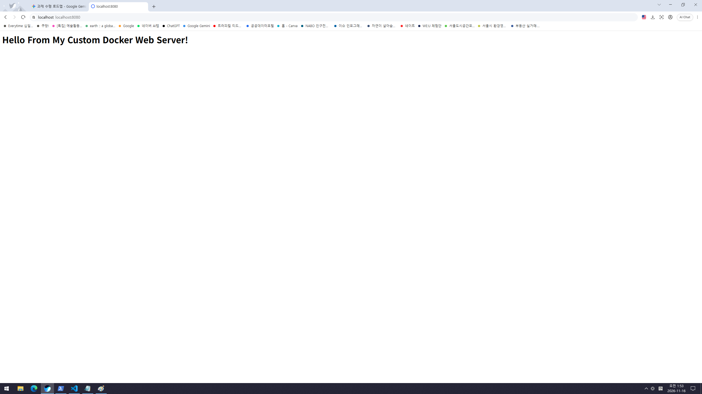
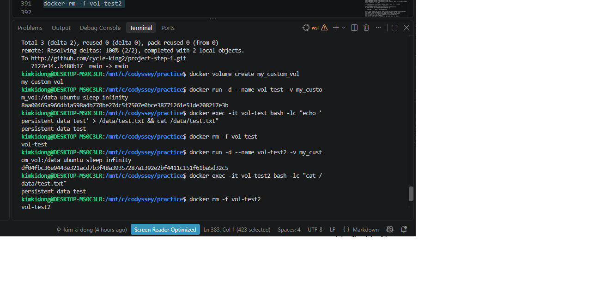

Markdown
## 1. 프로젝트 개요
로컬 개발 환경의 핵심 도구인 터미널(CLI), Docker(컨테이너), Git/GitHub(버전 관리 및 협업)를 직접 세팅하고 검증하여, 어디서든 재현 가능한 개발 워크스테이션을 구축하는 실습입니다.

---

## 2. 실행 환경
* **OS:** Windows 11 (WSL 2 Ubuntu 기반 Docker Engine)
* **Shell / Terminal:** PowerShell, Bash
* **Docker:** Docker Desktop 4.99.0 (Engine 29.9.3)
* **Git:** Git for Windows / WSL Git

---

## 3. 수행 항목 체크리스트
- [x] 터미널 기본 조작 및 작업 디렉토리 구성
- [x] 파일 및 디렉토리 권한 변경 실습
- [x] Docker 설치 및 버전/데몬 점검
- [x] 기본 컨테이너 (`hello-world`, `ubuntu`) 실행 및 운영 명령 확인
- [x] 커스텀 `Dockerfile` 작성 및 웹 서버 이미지 빌드
- [x] 포트 매핑 (`-p`)을 통한 브라우저 접속 확인
- [x] 바인드 마운트 실시간 반영 및 Docker 볼륨 영속성 검증
- [x] Git 사용자 설정 및 VS Code-GitHub 저장소 연동

---

## 4. 수행 로그 및 검증 결과

## 4. 수행 로그 및 검증 결과

---

> ### 4-1. 작업 디렉토리 및 기본 파일 생성 (PowerShell)
> **설명 및 구성 파일:**
> - `project-step-1/`
>   - `Dockerfile`: Nginx 기반 커스텀 웹 서버 이미지 빌드를 위한 설정 파일
>   - `README.md`: 개발 환경 구축, 명령어 실습 기록 및 재현 가이드 문서
>   - `app.txt`: 파일 생성·복사·이동·삭제 등 기본 셸 명령어 실습용 파일
>   - `hello.txt`: 파일 권한(chmod 755 등) 변경 및 권한 해석 실습용 파일
> 
> - **Dockerfile:** nginx:alpine 베이스 이미지를 기반으로 정적 웹 서버 환경을 컨테이너로 빌드하기 위한 정의 파일입니다. 다른 사용자가 동일 명령어(`docker build -t my-practice-app .`)로 오류 없이 이미지를 생성할 수 있도록 합니다.
> - **README.md:** 시스템을 처음 접하는 사람도 문서에 적힌 순서 그대로 따라 실행했을 때 동일한 결과를 얻을 수 있도록 기준을 제공합니다.
> - **app.txt and hello.txt:** 리눅스/WSL 환경에서의 파일 조작과 접근 권한 제어 실습을 위해 배치된 샘플 데이터 파일입니다.
> 
> **검증 방법:** `pwd`, `mkdir`, `echo`, `Get-ChildItem -Force` 명령어로 작업 경로를 생성하고 숨김 파일 포함 목록을 확인했습니다.
> 
> ```powershell
> PS C:\Users\sease> pwd
> 
> Path
> ----
> C:\Users\sease
> PS C:\Users\sease> cd..
> PS C:\Users> cd..
> PS C:\> mkdir -p codyssey/practice
> 
>     디렉터리: C:\codyssey
> 
> Mode                LastWriteTime         Length Name
> ----                -------------         ------ ----
> d-----     2026-11-16  오전 12:17                practice
> 
> PS C:\> cd codyssey/practice
> PS C:\codyssey\practice> echo "123" > test.txt
> PS C:\codyssey\practice> get-childitem -force
> 
>     디렉터리: C:\codyssey\practice
> 
> Mode                LastWriteTime         Length Name
> ----                -------------         ------ ----
> -a----     2026-11-16  오전 12:18             12 test.txt
> ```

---

> ### 4-2. Docker 설치 및 기본 점검
> **Docker image와 container란?**
> "이미지는 설계도(틀), 컨테이너는 그 설계도로 찍어낸 실물(실행 중인 상태)입니다."
> - **이미지:** 애플리케이션 실행에 필요한 코드, 라이브러리, 환경 설정 등을 모아둔 읽기 전용(Read-only) 템플릿
> - **컨테이너:** 이미지를 실행(Run)하여 메모리에 적재하고, 실제로 프로세스가 동작하는 상태
> 
> **특징:**
> 가. 이미지는 원본 파일은 절대 변경되지 않음 (수정 불가)
> 나. 컨테이너 내부에서 파일 생성·수정·삭제 등 쓰기(Write) 작업 가능
> 다. 이미지는 프로그램 설치 파일(ISO) 또는 붕어빵 틀
> 라. 컨테이너는 설치를 마쳐 실행 중인 프로그램 또는 실제 붕어빵
> 
> **추가설명: Dockerfile이란?**
> - 도커 컨테이너의 뼈대가 되는 도커 이미지를 자동으로 생성(Build)하기 위해 필요한 모든 지침과 설정들을 순차적으로 적어둔 텍스트 파일입니다.
> - "내 컴퓨터에서는 잘 되는데 서버에서는 안 돼요" 같은 환경 차이 문제를 원천적으로 방지합니다.
> 
> **추가설명2: 절대경로와 상대경로**
> - **절대 경로:** 최상위 루트 폴더부터 시작해서 목적지까지 거치는 모든 경로를 빠짐없이 적어주는 방식 (예: `/home/kimkidong/project`)
> - **상대 경로:** 현재 내가 작업하고 있는 위치를 기준으로 목적지까지 찾아가는 방식 (예: `./index.html`)
> 
> **검증 방법:** Docker Desktop 설치 및 WSL 2 연동 후 `docker version` 명령어를 통해 Client와 Server(엔진) 정상 구동 여부를 확인했습니다.
> 
> ```bash
> kimkidong@DESKTOP-MS0C3LR:/mnt/c/Users/sease$ docker version
> 
> Client:
>  Version:          29.9.3
>  API version:      1.56
>  Go version:       go1.26.10
>  Git commit:       5457199
>  Built:            Tue Nov  3 21:42:08 2026
>  OS/Arch:          linux/amd64
>  Context:          default
> 
> Server: Docker Desktop 4.99.0 (245822)
>  Engine:
>   Version:          29.9.3
>   API version:      1.56 (minimum version 1.40)
>   Go version:       go1.26.10
>   Git commit:       70efc0e
>   Built:            Tue Nov  3 21:41:42 2026
>   OS/Arch:          linux/amd64
>   Experimental:     false
>   containerd:
>    Version:          v2.4.2
>    runc:             Version: 1.5.2
> ```

---

> ### [트러블슈팅 1] 우분투 터미널에서 Docker Desktop 통합 설정 미적용 오류
> **증상:** `docker info` 실행 시 `Server: failed to connect to the docker API at npipe:////./pipe/docker_engine... The system cannot find the file specified.` 에러 발생
> 
> **원인:** WSL(Ubuntu) 환경에서 Docker Desktop 백그라운드 엔진과 통신 담당 WSL 통합(Integration) 설정이 활성화되지 않아 데몬과 연결하지 못하는 문제 발생.
> 
> **해결 방법:** Docker Desktop 설정 화면 이동 (`Settings > Resources > WSL integration`)
> 1. `Enable integration with my default WSL distro` 활성화
> 2. `Enable integration with additional distros` 목록에서 Ubuntu 스위치를 켜짐 상태로 설정 후 재적용
> 
> **결과 확인:** `docker version` 명령어를 다시 실행하여 서버 엔진이 정상 응답하는지 최종 검증 완료.

---

> ### [트러블슈팅 2] 포트 충돌 오류 (Port already allocated)
> **증상:** `docker run` 실행 시 `Bind for 0.0.0.0:8080 failed: port is already allocated` 에러 발생.
> 
> **원인:** 이미 이전 실습에서 8080 포트를 점유하고 있는 컨테이너가 실행 중인 상태에서 동일한 포트로 컨테이너를 또 띄우려 할 때 발생.
> 
> **해결 방법:** `docker ps`로 실행 중인 컨테이너를 확인한 뒤 `docker stop` 및 `docker rm`으로 기존 컨테이너를 정리하고 재실행.
> 
> ```bash
> kimkidong@DESKTOP-MS0C3LR:/mnt/c/codyssey/practice$ docker ps -a
> kimkidong@DESKTOP-MS0C3LR:/mnt/c/codyssey/practice$ docker stop web-server-1
> kimkidong@DESKTOP-MS0C3LR:/mnt/c/codyssey/practice$ docker rm my-ubutnu
> ```

---

> ### 4-3. 파일 및 디렉토리 권한 변경 실습
> **검증 방법:** 리눅스 네이티브 파일 시스템 환경에서 `chmod` 명령어를 사용하여 파일과 디렉토리의 접근 권한을 변경하고 결과를 검증했습니다.
> 
> - **1) 파일 권한 변경 (`hello.txt`: 644 → 755)**
>   ```bash
>   $ touch hello.txt
>   $ chmod 755 hello.txt
>   $ ls -l hello.txt
>   -rwxr-xr-x 1 kimkidong kimkidong 0 Nov 16 23:30 hello.txt
>   ```
>   *권한 해석 (755 = rwxr-xr-x): 소유자는 읽기·쓰기·실행이 모두 가능하며, 그룹과 기타 사용자는 읽기 및 실행만 가능합니다.*
> 
> - **2) 디렉토리 권한 변경 (`my_dir`: 755 → 700)**
>   ```bash
>   $ mkdir my_dir
>   $ chmod 700 my_dir
>   $ ls -ld my_dir
>   drwx------ 2 kimkidong kimkidong 4096 Nov 16 23:31 my_dir
>   ```
>   *권한 해석 (700 = drwx------): 소유자에게만 모든 권한을 부여하고, 그룹과 기타 사용자의 접근은 완전히 차단했습니다.*

---

> ### [트러블슈팅 3] 윈도우 파일 시스템(NTFS) 마운트 환경에서의 chmod 제약
> **현상:** `ls -l hello.txt` 실행 시 `-rwxrwxrwx 1 kimkidong kimkidong ...` 형태로 출력됨.
> 
> **진단:** 현 파일 위치 경로가 윈도우 파일 시스템(NTFS)을 WSL 2에서 마운트한 영역(DrvFs)이기 때문에 발생. 윈도우 파일 시스템은 리눅스의 정통 권한 체계(`chmod`)를 네이티브로 지원하지 않음. 이 때문에 터미널에서 `chmod 755`를 입력하더라도 실제 윈도우 권한과 매핑되는 방식 때문에 결과가 `-rwxrwxrwx`(777) 등으로 다르게 표시되거나 고정되어 나타남. 이는 WSL 환경에서 윈도우 드라이브를 사용할 때 매우 정상적인 동작입니다.
> 
> **해결 방법:** 755(`rwxr-xr-x`) 권한 변화를 테스트하려면, 윈도우 공유 폴더(`/mnt/c/...`)가 아닌 리눅스 내부 가상 디스크 영역(예: 홈 디렉토리 `~/codyssey/practice`)에 프로젝트를 생성하고 실습을 진행하면 리눅스 권한이 의도대로 정확히 적용됩니다.

---

> ### 4-4. 기본 컨테이너 (`hello-world`, `ubuntu`) 실행 및 운영 실습
> **검증 방법:** `docker run hello-world`로 도커 엔진의 정상 동작을 확인하고, `docker images` 및 `docker ps -a` 명령어로 이미지와 전체 컨테이너 목록 조회를 수행했습니다.
> 
> **1) `docker run hello-world` 실행 결과**
> ```bash
> kimkidong@DESKTOP-MS0C3LR:~/codyssey/practice$ docker run hello-world
> Hello from Docker!
> This message shows that your installation appears to be working correctly.
> To generate this message, Docker took the following steps:
> 1. The Docker client contacted the Docker daemon.
> 2. The Docker daemon pulled the "hello-world" image from the Docker Hub.
>    (linux/amd64)
> 3. The Docker daemon created a new container from that image which runs the
>    executable that produces the output you are currently reading.
> 4. The Docker daemon outputted that information to the streaming log and exited.
> 
> To try something more ambitious, you can run:
>  $ docker run -it ubuntu bash
> 
> Share your images, automate your builds, and share your work on a GitHub chat:
>  [https://hub.docker.com/](https://hub.docker.com/)
> ```
> 
> **2) `docker images` (로컬 이미지 목록 조회)**
> ```bash
> kimkidong@DESKTOP-MS0C3LR:~/codyssey/practice$ docker images
> REPOSITORY    TAG       IMAGE ID       DISK USAGE    CONTENT SIZE    EXTRA
> hello-world   latest    cf1b20a0c89a   25.9kB        9.49kB          U
> ubuntu        latest    065aa8626841   163MB         45.9MB          U
> ```
> 
> **3) `docker ps -a` (전체 컨테이너 목록 및 실행 상태 조회 - 필수 누락 보완)**
> ```bash
> kimkidong@DESKTOP-MS0C3LR:~/codyssey/practice$ docker ps -a
> CONTAINER ID   IMAGE         COMMAND                  CREATED          STATUS                      PORTS                 NAMES
> c2bd3bdb2687   0fd00ecfbd77  "/docker-entrypoint.…"   19 minutes ago   Up 19 minutes               80/tcp                elegant_lovelace
> 5c772b6cd9d5   my-web:1.0    "/docker-entrypoint.…"   13 hours ago     Exited (255) 20 minutes ago 0.0.0.0:8080->80/tcp  web-server-1
> 3a2a86eaa141   ubuntu        "bash"                   13 hours ago     Exited (0) 13 hours ago                           my-ubutnu
> b16d6c712807   hello-world   "/hello"                 13 hours ago     Exited (0) 13 hours ago                           clever_mcclintock
> a7ca8d35f59c   ubuntu        "bash"                   13 hours ago     Exited (0) 13 hours ago                           my-ubuntu
> d03f2c416329   hello-world   "/hello"                 13 hours ago     Exited (0) 13 hours ago                           heuristic_swirles
> ```

> ### 4-5. 터미널 파일 및 디렉토리 조작 상세 실습 (생성·복사·이동·삭제)
> **검증 방법:** 리눅스 터미널 환경에서 `touch`, `cp`, `mv`, `rm` 명령어를 사용해 파일과 디렉토리 생명주기를 관리했습니다.
> 
> ```bash
> # 1. 빈 파일 생성 및 내용 확인
> touch app.txt
> echo "Hello Codyssey" > app.txt
> cat app.txt
> # 출력: Hello Codyssey
> 
> # 2. 파일 복사 및 이동(이름 변경)
> cp app.txt backup.txt
> mv backup.txt moved_app.txt
> 
> # 3. 파일 삭제
> rm moved_app.txt
> ```
> 
> **Dockerfile 빌드 및 실행 로그:**
> ```bash
> kimkidong@DESKTOP-MS0C3LR:~/codyssey/practice$ docker build -t my-practice-app .
> [+] Building 2.5s (8/8) FINISHED
>  => [internal] load build definition from Dockerfile 0.0s
>  => [1/2] FROM docker.io/library/nginx:alpine        0.1s
>  => CACHED [2/2] COPY index.html /usr/share/nginx/html/index.html 0.0s
>  => exporting to image                              0.3s
> ```

---

> ### 4-6. 포트 매핑(-p)을 통한 웹 서버 컨테이너 실행 및 브라우저 접속
> **개념:** 도커 컨테이너는 리눅스 커널의 네트워크 네임스페이스 기술을 사용하여 독립된 네트워크 환경을 갖습니다. 외부(호스트)에서는 컨테이너 내부로 직접 접근이 불가하므로, 포트 매핑을 통해 호스트 컴퓨터의 포트와 컨테이너 내부 포트를 연결하는 포트 포워딩이 필요합니다.
> 
> **검증 방법:** 호스트의 `8080` 포트와 컨테이너의 `80` 포트를 연결(`-p 8080:80`)하여 Nginx 웹 서버를 실행하고, 브라우저 및 터미널에서 정상 접속을 확인했습니다.
> 
> ```bash
> kimkidong@DESKTOP-MS0C3LR:~/codyssey/practice$ docker run -d --name web-server-1 -p 8080:80 my-web:1.0
> 5c772b6cd9d580fcfc14d9e03d42b918f6d7075c3ef270e55b6efc687e1a329d
> 
> kimkidong@DESKTOP-MS0C3LR:~/codyssey/practice$ docker ps
> CONTAINER ID   IMAGE        COMMAND                  CREATED         STATUS        PORTS                  NAMES
> 5c772b6cd9d5   my-web:1.0   "/docker-entrypoint.…"   5 seconds ago   Up 4 seconds  0.0.0.0:8080->80/tcp   web-server-1
> ```
> 
> 
> 

---

> ### 4-7. 도커 컨테이너 중지, 삭제 및 상태 점검 (stop, rm, ps)
> **검증 방법:** `docker stop`, `docker rm`, `docker ps` 명령어를 통해 컨테이너의 생명주기를 제어하고 실태를 점검했습니다.
> 
> ```bash
> kimkidong@DESKTOP-MS0C3LR:~/codyssey/practice$ docker stop web-container
> kimkidong@DESKTOP-MS0C3LR:~/codyssey/practice$ docker rm web-container
> kimkidong@DESKTOP-MS0C3LR:~/codyssey/practice$ docker ps -a
> ```

---

> ### 4-8. Docker 볼륨 영속성 검증
> **검증 방법:** 도커 볼륨을 생성하고 컨테이너에 연결한 뒤, 컨테이너 삭제 전후로 데이터가 유지되는지 검증했습니다.
> 
> ```bash
> kimkidong@DESKTOP-MS0C3LR:~/codyssey/practice$ docker volume create my_custom_vol
> my_custom_vol
> 
> kimkidong@DESKTOP-MS0C3LR:~/codyssey/practice$ docker run -d --name vol-test -v my_custom_vol:/data ubuntu sleep infinity
> kimkidong@DESKTOP-MS0C3LR:~/codyssey/practice$ docker exec -it vol-test bash -lc "echo 'persistent data test' > /data/test.txt && cat /data/test.txt"
> persistent data test
> 
> kimkidong@DESKTOP-MS0C3LR:~/codyssey/practice$ docker rm -f vol-test
> kimkidong@DESKTOP-MS0C3LR:~/codyssey/practice$ docker run -d --name vol-test2 -v my_custom_vol:/data ubuntu sleep infinity
> kimkidong@DESKTOP-MS0C3LR:~/codyssey/practice$ docker exec -it vol-test2 bash -lc "cat /data/test.txt"
> persistent data test
> kimkidong@DESKTOP-MS0C3LR:~/codyssey/practice$ docker rm -f vol-test2
> ```
> 
> **도커 볼륨 백업 수행:**
> ```bash
> docker run --rm -v my_custom_vol:/volume -v $(pwd):/backup alpine tar czvf /backup/vol_backup.tar.gz -C /volume .
> ```
> 
> 
> 

---

> ### 4-9. Git 설정 및 GitHub 연동
> **검증 방법:** 사용자 정보를 설정하고 저장소를 연동하여 최종 푸시를 완료했습니다.
> 
> ```bash
> git config --global user.name "kimkidong"
> git config --global user.email "seasee77@gmail.com"
> git init
> git branch -M main
> git remote add origin <GitHub_Repository_URL>
> git add .
> git commit -m "docs: Lab 4-1 ~ 4-8 워크스테이션 구축 및 도커/깃 실습 완료"
> git push -u origin main
> ```
> 
> 
> 
> **최신 버전 반영 및 커밋 푸시:**
> ```bash
> kimkidong@DESKTOP-MS0C3LR:~/codyssey/practice$ git add .
> kimkidong@DESKTOP-MS0C3LR:~/codyssey/practice$ git commit -m "docs:최신 버전 반영"
> kimkidong@DESKTOP-MS0C3LR:~/codyssey/practice$ git push -u origin main --force
> ```

---

> ### [트러블슈팅 4] 원격 저장소 충돌 및 푸시 거부 (Non-Fast-Forward / Reject)
> **증상:** `git push origin main` 실행 시 `! [rejected] main -> main (fetch first)` 및 `error: failed to push some refs...` 에러 발생.
> 
> **원인:** 원격 저장소(GitHub)에 로컬 저장소에는 없는 파일(예: 깃허브 생성 시 자동으로 만들어진 `README.md`, `.gitignore`, `LICENSE` 등)이 먼저 존재하기 때문에, 깃허브가 데이터를 덮어쓰는 것을 방지하기 위해 푸시를 거부(Reject)한 상황.
> 
> **진단:** 깃허브에 있는 변경 사항을 먼저 내 컴퓨터로 끌어온(Pull) 후 푸시해야 함. 만약 깃허브와 로컬을 각각 따로 초기화(`git init`)한 경우 히스토리가 달라 충돌 발생.
> 
> **해결 방법:** 로컬(VS Code)에 있는 코드가 최신 버전이므로, 깃허브에 있는 내용을 무시하고 내 컴퓨터 기준으로 깃허브를 완전히 덮어씌우기 위해 강제 푸시(`--force`) 옵션을 활용하여 정상적으로 동기화를 완료함.
> 
> ```bash
> kimkidong@DESKTOP-MS0C3LR:~/codyssey/practice$ git push -u origin main --force
> To [https://github.com/cycle-king2/project-step-1.git](https://github.com/cycle-king2/project-step-1.git)
>    389d84d..7be34b1  main -> main
> branch 'main' set up to track 'origin/main'.
> ```